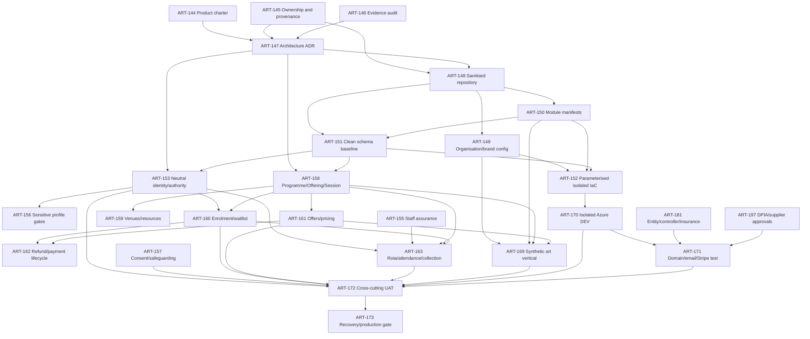

# ART-146 — evidence-based extraction sequence

**Decision basis:** Kaizen source `44101ef2fc772e0903ff926247a01597a439a2a3`, live-site cross-check, Azure read-only inventory, and Linear relations inspected on 2026-11-06.
**Constraint:** no permanent copy-and-rename fork; extract a versioned core, explicit vertical packs and isolated per-organisation deployments.

## Executive recommendation

The proposed broad path is directionally right, but the code changes its middle. Identity and programme/session design are foundational aggregates, not late feature ports. Module manifests must govern API mounts, schemas/migrations, permissions, jobs, generated types, navigation, seeds and provider dependencies before a clean baseline can be trusted. Infrastructure cannot be safely parameterised from brand strings alone.

The next actionable engineering/product ticket is **ART-144**. It can proceed now and defines what belongs in the vanilla MVP. **ART-145** is an equally necessary human/legal gate and should proceed in parallel. ART-147 must remain blocked until ART-144, ART-145 and ART-146 are accepted.

## Dependency graph

The graph shows the material path, not permission to start every unblocked Linear issue. Work should move in small reviewable slices after the owning ticket's acceptance criteria and legal gates are satisfied.

## Recommended execution stages

| Stage | Tickets | Evidence-based outcome / exit gate |
|---|---|---|
| 0. Scope and provenance | ART-144, ART-145, ART-146 | MVP and non-goals are explicit; ownership/licensing is documented; this audit is reviewed. No Kaizen or Cygnets tenant content/data is authorised by default. |
| 1. Architecture decision | ART-147 | ADR approves versioned core + vertical packs + isolated deployments and identifies package/release ownership. Do not advance it while 144/145 remain unresolved. |
| 2. Sanitised foundation | ART-148 | New repository has provenance, contribution/security rules and only authorised source; no runtime data, secrets, generated state or tenant IP. |
| 3. Configuration and module boundaries | ART-149, ART-150 | Validated organisation config replaces compiled brand/provider identity. Module manifests control routes, migrations, jobs, permissions, generated types, nav, seeds and provider dependencies. |
| 4. Clean persistence boundary | ART-151 | Forward-only neutral baseline; existing Kaizen migrations are source history, not the new schema. Audit/security/idempotency invariants have regression tests. |
| 5. Isolated infrastructure template | ART-152 | All names, domains, regions, SKU/cost/scaling settings, identities and GitHub subject are parameterised and validated. A what-if/config-isolation proof exists; no resources are provisioned yet. |
| 6. Identity and delivery foundations | ART-153–ART-159 | Adult and child authority is greenfield; least privilege, staff assurance, approved sensitive data/consent and Programme→Offering→Session plus venue/resource constraints are implemented. |
| 7. Operational and commercial modules | ART-160–ART-168 | Enrolment/capacity, configurable offers, refunds, registers/collection, public discovery, CMS, enquiries, reporting and controlled import/export land only as selected by ART-144. |
| 8. Synthetic reference tenant | ART-169 | Original RiverThames configuration and synthetic people/programmes/content prove module composition. No source-system personal data or content is used. |
| 9. Isolated DEV | ART-170 | Bicep provisions a separate resource group, database, storage, Key Vault, identities and telemetry with cost controls, OIDC and synthetic data only. |
| 10. External test providers | ART-171 plus ART-181/197 | Separate test domain/email/Stripe configuration is approved and connected; no Kaizen identifiers or access paths remain. |
| 11. Acceptance and recovery | ART-172, ART-173 | Accessibility, authority, safeguarding, security, billing and business UAT pass; backup/restore and key/provider recovery are rehearsed before an explicit production decision. |

## Why the original middle order must change

1. **ART-149 and ART-150 need the sanitised repo boundary.** Their Linear records currently have no `blockedBy` relation, but implementing them in the Kaizen repository risks another implicit fork. Recommend linking ART-148 → ART-149 and ART-148 → ART-150.
2. **ART-150 precedes ART-151.** All 62 API router objects are mounted unconditionally today. Feature flags generally fail handlers closed but do not remove routes, OpenAPI surface, imports or migrations. A vertical boundary that only hides navigation is insufficient.
3. **ART-151 precedes identity and scheduling.** The 118-table Kaizen schema embeds mandatory Guardian→Member and Discipline→ScheduledClass assumptions. Nullable fields and terminology changes would preserve the wrong invariants.
4. **ART-153 and ART-158 can proceed in parallel after the baseline, then converge at ART-160/163.** Enrolment cannot be correct without both authority/payer and offer/session identity.
5. **ART-152 can run in parallel with domain modules once ART-149/150/151 pass.** ART-170 remains strictly behind ART-152; infrastructure creation does not need to wait for every business module.
6. **ART-169 is not a data migration.** It must use original art-school content and conspicuously synthetic identities, payments, media and communications.
7. **ART-171 is governance-gated.** ART-181 and ART-197 correctly block live provider setup even after isolated DEV exists.

## Linear relation reconciliation

### Relations already correct

- ART-144, ART-145 and ART-146 block ART-147.
- ART-145 and ART-147 block ART-148.
- ART-148, ART-150 and ART-147 block ART-151.
- ART-149, ART-150 and ART-151 block ART-152, which blocks ART-170.
- ART-151/147 block ART-153 and ART-158.
- ART-153 and ART-158 block ART-160; ART-160/161 block ART-162.
- ART-153/155/158/160 block ART-163.
- ART-149/150/158/161 block ART-169.
- ART-170 plus ART-181/197 block ART-171.
- ART-170/171/157/160/163/161/153/169 block ART-172, which blocks ART-173.

### Recommended relation corrections (not new issues)

- Add ART-148 as a blocker for ART-149 and ART-150.
- Add ART-159 as a blocker for the capacity/resource portions of ART-160 and ART-163, or explicitly narrow those acceptance criteria.
- Add ART-154 as a blocker for ART-172 because the UAT title includes authority/security/MFA.
- Add ART-156 as a blocker for ART-172 because accessibility and controlled emergency/health data are explicit UAT subjects.
- Consider ART-164–ART-168 as ART-172 blockers only where ART-144 places those surfaces in MVP; avoid creating false critical-path work by default.

## Extraction units and regression gates

| Extraction unit | Carry forward | Must be replaced/excluded | Minimum regression gate |
|---|---|---|---|
| Auth/security | Sessions, revocation, invitations, password flows, TOTP, recovery, step-up | Kaizen browser keys, copy and provider config | Positive/negative auth, session revocation, MFA recovery, rate limits and audit tests |
| Capabilities/audit | Deny-by-default checks, append-only evidence | Martial role labels and broad admin assumptions | Capability matrix with denial tests for operator, teacher, assistant, DSL, payer and learner |
| Organisation configuration | Validation and safe public/private split | Hardcoded name/domain/nav/origins/email/Stripe links | Unknown-key rejection, secret-leak scan, two-tenant config-isolation test |
| Module system | New manifest/ownership contract | Unconditional router/import/migration/nav loading | Disabled module absent from routes/OpenAPI/nav/jobs/schema and cannot grant orphan capabilities |
| Identity | Opaque Person and evented authority ideas | Mandatory Guardian ownership, duplicate PII, NEST reconciliation | Adult, child, sibling, staff-learner, restricted and expired-authority tests |
| Programmes/sessions | Recurrence/override lessons | Discipline, grading, one-instructor/one-room assumptions | Recurrence/time-zone/DST, conflict, capacity and cancellation tests |
| Commerce | Idempotent Stripe/webhook/transaction patterns | Family membership/three-term catalogue and provider IDs | Duplicate webhook, partial/full refund, failed payment and reconciliation tests |
| Content/media | CMS states, redirects, media evidence | Copy, biographies, legal text, photos, syllabus/research | Publication/withdrawal, consent revocation, origin/SEO and asset-ownership tests |
| Infrastructure | Bicep/azd/OIDC structure, managed identity and Key Vault pattern | `kia-*`, fixed repo/RG/app/domain/SKU/provider settings | lint/build/what-if, naming validation, least-privilege identity, scale/cost and isolation evidence |

## Stop conditions

Stop extraction and return to the owning ticket when any slice would require copying unknown-provenance code/content, opening live child/customer data, reading/exporting secrets, inventing legal text, provisioning Azure before ART-152, configuring providers before ART-171, or weakening audit/authority tests to fit the legacy model.

## Completion position for ART-146

The engineering discovery is complete enough to inform the ADR and product charter, with six repository documents and a Linear summary. ART-146 should remain in its current status until the evidence pack is reviewed; completion must not implicitly advance ART-147 while ART-144 or ART-145 is unresolved.
